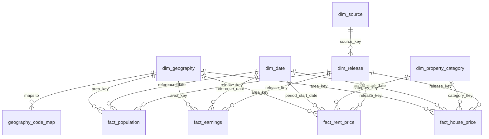

# Data Model

_Status: draft v0.2. Based on the source inspections in `data_sources.md`, including the PIPR schema inspection._

## 1. Design Principles

Each principle comes from a specific finding in the source data.

| Principle                                    | Why (evidence)                                                                                                                                |
| -------------------------------------------- | --------------------------------------------------------------------------------------------------------------------------------------------- |
| **Join on official area codes, never names** | Names differ between sources (`"North East "` with a trailing space in ASHE; `"Monmouthshire / Sir Fynwy"`)                                   |
| **Map code versions explicitly**             | Barnsley and Sheffield use 2023 codes in population estimates but 2024+ codes in UK HPI and ASHE                                              |
| **Keep every release; never overwrite**      | All five sources revise history (UK HPI monthly, ASHE yearly, population back to 2022)                                                        |
| **Store each measure at its true frequency** | NI house prices are quarterly but published as repeated monthly rows; earnings are annual (April); population is annual (30 June)             |
| **Nulls carry a reason**                     | Sources distinguish unreliable, disclosive, not available, not applicable and "not published yet". All of these would be lost as a plain null |
| **Carry quality into the marts**             | Annual earnings CVs reach 17% for some districts, which is enough to change affordability rankings                                            |
| **One source per level**                     | ONS and NISRA give different NI totals, and country totals ≠ sum of local authorities. Each level comes from exactly one source               |

## 2. Where Each Layer Lives

This resolves the "gold in two places" question from the original architecture.

| Layer                  | Location                                   | Content                                                                          | Format                  |
| ---------------------- | ------------------------------------------ | -------------------------------------------------------------------------------- | ----------------------- |
| Bronze                 | ADLS Gen2 `bronze/`                        | Original files, exactly as downloaded, partitioned by source and release date    | `.xlsx`, `.csv`, `.zip` |
| Silver                 | ADLS Gen2 `silver/`                        | Parsed, cleaned, long-format tables, one per source table, with release metadata | Parquet                 |
| Raw                    | PostgreSQL schema `raw`                    | Silver tables loaded as-is                                                       | Tables                  |
| Staging / intermediate | PostgreSQL `staging`, `intermediate` (dbt) | Renamed, typed, code-mapped, deduplicated                                        | Views / tables          |
| Marts (gold)           | PostgreSQL `marts` (dbt)                   | Dimensions, facts and analytical marts for Power BI                              | Tables                  |

**Gold lives in PostgreSQL only.** The lake holds files (bronze, silver), and the database holds modelled data.

Example bronze path: `bronze/uk_hpi/release_date=2026-10-21/UK-HPI-full-file-2026-08.csv`

## 3. Entity Relationship Diagram

## 4. Dimensions

### `dim_geography`

One row per area code. Codes that change get a new row, with the old row end-dated.

| Column                    | Type         | Description                                                                                                                                    |
| ------------------------- | ------------ | ---------------------------------------------------------------------------------------------------------------------------------------------- |
| `area_key`                | `integer` PK | Surrogate key                                                                                                                                  |
| `area_code`               | `char(9)`    | Official GSS code, e.g. `E08000038`                                                                                                            |
| `area_name`               | `text`       | Clean name (trimmed)                                                                                                                           |
| `geography_level`         | `text`       | `uk`, `gb`, `england_wales`, `country`, `region`, `county`, `lower_tier_la`, `brma` (rental market areas in Scotland and NI, from PIPR)        |
| `la_type`                 | `text`       | `unitary`, `shire_district`, `metropolitan_district`, `london_borough`, `welsh_ua`, `scottish_ca`, `ni_lgd` (null above local authority level) |
| `country_code`            | `char(9)`    | E92 / W92 / S92 / N92 code                                                                                                                     |
| `region_code`             | `char(9)`    | English region (E12); null outside England                                                                                                     |
| `is_lower_tier_la`        | `boolean`    | True for the 361 analysis areas                                                                                                                |
| `valid_from` / `valid_to` | `date`       | Code validity (e.g. Barnsley `E08000016` ends 2024-03-31)                                                                                      |
| `is_current`              | `boolean`    | Current code version                                                                                                                           |

`geography_level` and `la_type` are derived from the code prefix (E06, E07, E08, E09, W06, S12, N09 …), not from row indentation in the source files.

**Reference list:** the 361 lower-tier local authorities in the population estimates (MYEB3), updated to current codes.

**Missing input:** a **local authority → region lookup**. No inspected source gives this cleanly (ASHE only shows it through indentation). Add the ONS Open Geography Portal _"Local Authority District to Region"_ lookup as a small reference source.

### `geography_code_map`

Maps the code a source uses to the current code.

| Column         | Type      | Description                    |
| -------------- | --------- | ------------------------------ |
| `source_code`  | `char(9)` | Code as it appears in a source |
| `current_code` | `char(9)` | Current code                   |
| `change_date`  | `date`    | When the change took effect    |
| `change_type`  | `text`    | `recoded`, `merged`, `split`   |
| `note`         | `text`    | Free text                      |

Known rows so far:

| `source_code` | `current_code` | `change_type` | `note`                                                    |
| ------------- | -------------- | ------------- | --------------------------------------------------------- |
| `E08000016`   | `E08000038`    | `recoded`     | Barnsley. Used by population estimates (2023 boundaries)  |
| `E08000019`   | `E08000039`    | `recoded`     | Sheffield. Used by population estimates (2023 boundaries) |

All staging models join through this table, so a source on old codes still lands on current codes.

### `dim_date`

One row per calendar day. Facts reference the **start date of their period**, and carry a `period_type`.

| Column                         | Type       | Description                                                              |
| ------------------------------ | ---------- | ------------------------------------------------------------------------ |
| `date`                         | `date` PK  | Calendar date                                                            |
| `year`, `quarter`, `month`     | `smallint` | Calendar parts                                                           |
| `month_start`, `quarter_start` | `date`     | Helpers for monthly/quarterly joins                                      |
| `tax_year_ending`              | `smallint` | Year of the 5 April that ends the tax year (aligns with ASHE annual pay) |

### `dim_property_category`

| Column           | Type         | Description                                                                                                                          |
| ---------------- | ------------ | ------------------------------------------------------------------------------------------------------------------------------------ |
| `category_key`   | `integer` PK | Surrogate key                                                                                                                        |
| `category_code`  | `text`       | e.g. `all`, `detached`, `semi_detached`, `terraced`, `flat`, `new_build`, `existing`, `cash`, `mortgage`, `ftb`, `foo`, `one_bed`, … |
| `category_group` | `text`       | `all`, `property_type`, `build_status`, `funding`, `buyer_type`, `bedrooms`                                                          |
| `applies_to`     | `text`       | `house_price`, `rent` or `both`                                                                                                      |

The UK HPI CSV gives 12 house price categories. The PIPR categories (nine, including bedroom counts) are to be confirmed when PIPR is re-inspected.

### `dim_source` and `dim_release`

`dim_release` is what makes revision handling work. Every loaded file is a release.

**`dim_source`**

| Column          | Type         | Description                                                    |
| --------------- | ------------ | -------------------------------------------------------------- |
| `source_key`    | `integer` PK |                                                                |
| `source_code`   | `text`       | `uk_hpi`, `pipr`, `ashe_ons`, `ashe_nisra`, `mye`, `bank_rate` |
| `publisher`     | `text`       | HM Land Registry, ONS, NISRA, Bank of England                  |
| `load_strategy` | `text`       | `append_release` or `full_refresh`                             |

**`dim_release`**

| Column         | Type         | Description                             |
| -------------- | ------------ | --------------------------------------- |
| `release_key`  | `integer` PK |                                         |
| `source_key`   | `integer` FK |                                         |
| `published_at` | `timestamp`  | Publisher's release date/time           |
| `ingested_at`  | `timestamp`  | When our pipeline loaded it             |
| `edition`      | `text`       | `provisional`, `revised` or `final`     |
| `file_name`    | `text`       | Original file name                      |
| `file_sha256`  | `char(64)`   | Detects re-downloads of identical files |
| `bronze_path`  | `text`       | Link back to the original file          |

## 5. Facts

All facts share these conventions:

- **Append-only.** Each release adds rows and nothing is updated in place. The natural key includes `release_key`.
- **`value_status`** on every row: `published`, `provisional`, `unreliable`, `disclosive`, `not_available`, `not_applicable`, `not_yet_published`.
- **Current views.** dbt builds `*_current` models that keep the latest release per natural key. Power BI reads these.

### `fact_house_price`

**Grain:** one row per `area` × `period` × `property_category` × `release`.

| Column              | Type            | Description                                                          |
| ------------------- | --------------- | -------------------------------------------------------------------- |
| `area_key`          | FK              |                                                                      |
| `period_start_date` | FK `dim_date`   | 1st of the month, or 1st of the quarter for NI                       |
| `period_type`       | `text`          | `month` or `quarter`                                                 |
| `category_key`      | FK              |                                                                      |
| `release_key`       | FK              |                                                                      |
| `average_price_gbp` | `numeric(12,0)` |                                                                      |
| `price_index`       | `numeric(8,2)`  | As published (confirm the base period from the UK HPI documentation) |
| `change_1m_pct`     | `numeric(6,2)`  | Monthly (or quarterly for NI) % change                               |
| `change_12m_pct`    | `numeric(6,2)`  | Annual % change                                                      |
| `sales_volume`      | `integer`       | Null with `not_yet_published` for the latest two months              |
| `value_status`      | `text`          |                                                                      |

**Measures are columns, not rows.** Price, index and changes always share the same grain, so a fully long (one row per measure) table would add joins without adding flexibility.

**Load rules:**

- **NI districts (N09):** collapse the three repeated monthly rows into one quarterly row. Drop months past the latest published quarter (e.g. July and August 2026), because they are repeated Q2 values, not data.
- **Seasonally adjusted columns:** load only for areas where they are present (higher-level areas). They are 96% null overall.
- **Provisional status:** set from the UK HPI revisions files, because the CSV has no `[p]`/`[r]` markers.

Estimated size: about 152k area-months × up to 12 categories → about 1.2M rows per release. Keeping every monthly release in full grows by that much each month, so storing only rows that changed versus the previous release (using the revisions files) is a later optimisation.

### `fact_rent_price`

**Grain:** one row per `area` × `month` × `rent_category` × `release`.

| Column                                                         | Type            | Description                                                                 |
| -------------------------------------------------------------- | --------------- | --------------------------------------------------------------------------- |
| `area_key`, `period_start_date`, `category_key`, `release_key` | FKs             |                                                                             |
| `average_rent_gbp`                                             | `integer`       | Monthly rent, rounded to £1 at source                                       |
| `rent_index`                                                   | `numeric(10,6)` | January 2023 = 100                                                          |
| `change_1m_pct`, `change_12m_pct`                              | `numeric(10,6)` |                                                                             |
| `value_status`                                                 | `text`          | `[x]` → `not_available` (or `not_yet_published` for NI's latest two months) |

**Areas:** 316 England and Wales local authorities, 18 Scottish BRMAs (S33 codes), 8 NI BRMAs (synthetic codes `NIBRMA01`–`08` from a seed file, because the source code is `[z]`), the 9 English regions, the four countries, UK and GB.

**Categories (9):** `all`, `one_bed`, `two_bed`, `three_bed`, `four_plus_bed`, `detached`, `semi_detached`, `terraced`, `flat_maisonette`.

Size: 50,337 area-months × 9 categories ≈ 453k rows per release.

### `fact_earnings`

**Grain:** one row per `area` × `survey_year` × `worker_group` × `pay_period` × `release`.

| Column                | Type            | Description                                                                  |
| --------------------- | --------------- | ---------------------------------------------------------------------------- |
| `area_key`            | FK              |                                                                              |
| `reference_date`      | FK `dim_date`   | April of the survey year                                                     |
| `worker_group`        | `text`          | `full_time` initially (`all`, `male_full_time` … later)                      |
| `pay_period`          | `text`          | `weekly` (Table 8.1) or `annual` (Table 8.7)                                 |
| `release_key`         | FK              | ONS or NISRA release                                                         |
| `median_pay_gbp`      | `numeric(10,1)` |                                                                              |
| `median_change_pct`   | `numeric(6,1)`  |                                                                              |
| `mean_pay_gbp`        | `numeric(10,1)` |                                                                              |
| `mean_change_pct`     | `numeric(6,1)`  |                                                                              |
| `p10_gbp` … `p90_gbp` | `numeric(10,1)` | 10 percentile columns                                                        |
| `median_cv_pct`       | `numeric(5,1)`  | From 8.1b / 8.7b, or the NISRA CV sheet                                      |
| `quality_band`        | `text`          | `precise` (≤5), `reasonably_precise` (≤10), `acceptable` (≤20), `unreliable` |
| `job_count_thousands` | `integer`       | Indicative only. Not for weighting                                           |
| `value_status`        | `text`          | Status of the median                                                         |

**Source rules:**

- E, W, S lower-tier local authorities and all country/UK rows come from **ONS**.
- The 11 NI local authorities come from **NISRA**.
- NISRA's own NI total is **not loaded**, because ONS's N92000002 is used instead.
- County and region rows are loaded with their own `geography_level`, so they are never summed with districts.

### `fact_population`

**Grain:** one row per `area` × `year` × `release`.

| Column                                                       | Type          | Description                                      |
| ------------------------------------------------------------ | ------------- | ------------------------------------------------ |
| `area_key`                                                   | FK            | Mapped to current codes via `geography_code_map` |
| `reference_date`                                             | FK `dim_date` | 30 June                                          |
| `release_key`                                                | FK            |                                                  |
| `population`                                                 | `integer`     |                                                  |
| `births`, `deaths`, `natural_change`                         | `integer`     | Year to 30 June                                  |
| `internal_in`, `internal_out`, `internal_net`                | `integer`     |                                                  |
| `international_in`, `international_out`, `international_net` | `integer`     |                                                  |
| `other_change`                                               | `integer`     |                                                  |

**Load strategy:** `full_refresh`. Each release replaces the current view of the whole series (ONS advises against mixing releases), but earlier releases are kept for audit.

Age/sex detail (MYEB1) goes in a separate `fact_population_age` later, if needed.

### `fact_bank_rate` _(later)_

**Grain:** one row per rate change (`effective_date`, `bank_rate_pct`). It is event-driven, so marts expand it to a monthly rate with a date spine.

## 6. Analytical Marts

These are what Power BI reads. Each mart has an explicit definition, because the sources disagree on timing.

### `mart_affordability_annual`

**Grain:** one row per lower-tier local authority × survey year.

| Column                                   | Definition                                                                                                                                                                                                                                                                                               |
| ---------------------------------------- | -------------------------------------------------------------------------------------------------------------------------------------------------------------------------------------------------------------------------------------------------------------------------------------------------------- |
| `house_price_to_earnings`                | Mean of the monthly HPI `average_price_gbp` (all properties) over the 12 months ending April ÷ annual full-time median earnings (Table 8.7, same survey year). Earnings cover the tax year to 5 April, so the price window matches                                                                       |
| `rent_to_earnings_pct`                   | Weekly-equivalent rent (monthly rent × 12 ÷ 52) ÷ weekly full-time median earnings (Table 8.1), April of the survey year. Rent is converted to weekly, so earnings are left in their published form. **England and Wales local authorities only** (PIPR has no local authority rents for Scotland or NI) |
| `earnings_quality_band`                  | Worst `quality_band` of the earnings figures used                                                                                                                                                                                                                                                        |
| `is_rankable`                            | False if earnings are suppressed or have CV > 10%                                                                                                                                                                                                                                                        |
| `population`, `population_growth_5y_pct` | From `fact_population`                                                                                                                                                                                                                                                                                   |
| `coverage_note`                          | Explains any gap (see section 7)                                                                                                                                                                                                                                                                         |

**Note:** the UK HPI average price is a mix-adjusted _mean_, while ONS's official affordability ratios use _median_ prices from Price Paid Data. The ratios here are therefore not directly comparable to ONS's published ratios. This should be stated on the dashboard.

### `mart_house_price_trends`

Monthly (quarterly for NI) prices and indices by area and category, using `fact_house_price_current`, with `period_type` exposed so charts don't treat NI quarters as months.

### `mart_affordability_rankings`

Ranks local authorities by `house_price_to_earnings` within each year, using only `is_rankable` rows. It includes a 3-year rolling version once earnings history is loaded.

## 7. Coverage Matrix

Lower-tier local authorities (361 in total):

| Source       | England (296) | Wales (22) | Scotland (32) | NI (11)      | Gaps                                                                             |
| ------------ | ------------- | ---------- | ------------- | ------------ | -------------------------------------------------------------------------------- |
| UK HPI       | 295 monthly   | 22 monthly | 32 monthly    | 11 quarterly | Isles of Scilly absent                                                           |
| PIPR         | 294 monthly   | 22 monthly | 18 BRMAs only | 8 BRMAs only | City of London and Isles of Scilly absent. NI latest two months unavailable      |
| ASHE (ONS)   | 296           | 22         | 32            | —            | Annual median suppressed: City of London, Isles of Scilly, Monmouthshire, Orkney |
| ASHE (NISRA) | —             | —          | —             | 11           | None                                                                             |
| Population   | 296           | 22         | 32            | 11           | None (2023 codes, mapped)                                                        |

So `house_price_to_earnings` is available for **356 of 361** local authorities in 2026:

- Isles of Scilly: no house price data and no earnings.
- City of London, Monmouthshire, Orkney Islands: no annual earnings median.

`rent_to_earnings_pct` is available for **316 local authorities** (England 294, Wales 22):

- Not available for City of London and Isles of Scilly (no rent data).
- Not available for any Scottish or NI local authority (rents are published only for BRMAs).

All of these appear in the mart with a null ratio and a `coverage_note`, rather than being dropped.

**Scotland and NI rents (v1 approach):** shown at country level in all marts, and at BRMA level in a separate `mart_rent_brma` view. Assigning BRMA rents to local authorities would need a BRMA → local authority mapping with population weights, because the boundaries don't align. That is a possible later enhancement, not v1.

## 8. Data Tests (dbt)

| Test                  | Model                       | Rule                                                                   |
| --------------------- | --------------------------- | ---------------------------------------------------------------------- |
| Unique natural key    | All facts                   | `area_key` + period + category/group + `release_key`                   |
| Referential integrity | All facts                   | Every `area_key` exists in `dim_geography`                             |
| Code mapping complete | Staging                     | No source code is missing from `dim_geography` or `geography_code_map` |
| Lower-tier count      | `dim_geography`             | Exactly 361 current lower-tier local authorities                       |
| NI periodicity        | `fact_house_price`          | N09 rows have `period_type = 'quarter'`                                |
| No zero-filled nulls  | All facts                   | Measures are never 0 when `value_status` ≠ `published`                 |
| Quality warning       | `mart_affordability_annual` | Warn when a ratio uses earnings with CV > 10%                          |
| Release freshness     | `dim_release`               | Warn if the latest UK HPI release is older than 45 days                |

## 9. Open Decisions

**Decided (11 November 2026):**

- **Gold location:** PostgreSQL only (section 2).
- **Affordability definitions:** the 12-months-to-April price window and the weekly rent conversion (section 6).
- **PIPR keys:** the 8 code-less rows are NI BRMAs, which get synthetic codes from a seed file.
- **Scotland / NI rents:** country and BRMA level only in v1. No local authority rent-to-earnings outside England and Wales.

**Still open:**

1. **Release storage for UK HPI.** Store full monthly releases, or only changed rows? Full releases are simpler to start with.
2. **Region lookup.** Add the ONS LAD → region lookup as a reference source. PIPR's region names cover 294 English local authorities but have no codes, and miss City of London and Isles of Scilly, so the official lookup is still cleaner.
3. **Earnings history.** How many past ASHE/NISRA editions to load (2015 onwards would match PIPR).
